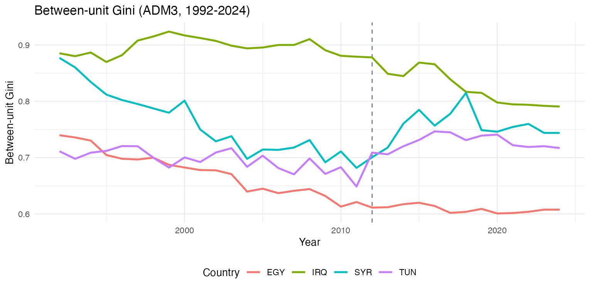
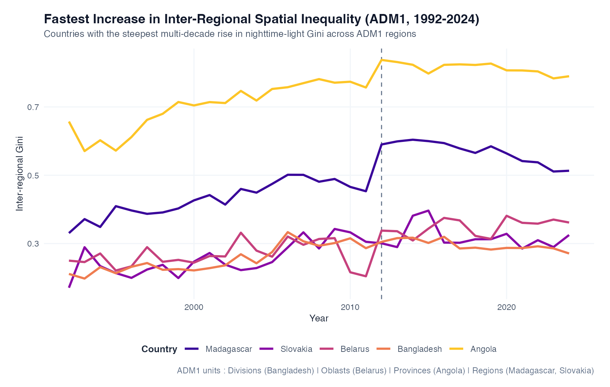
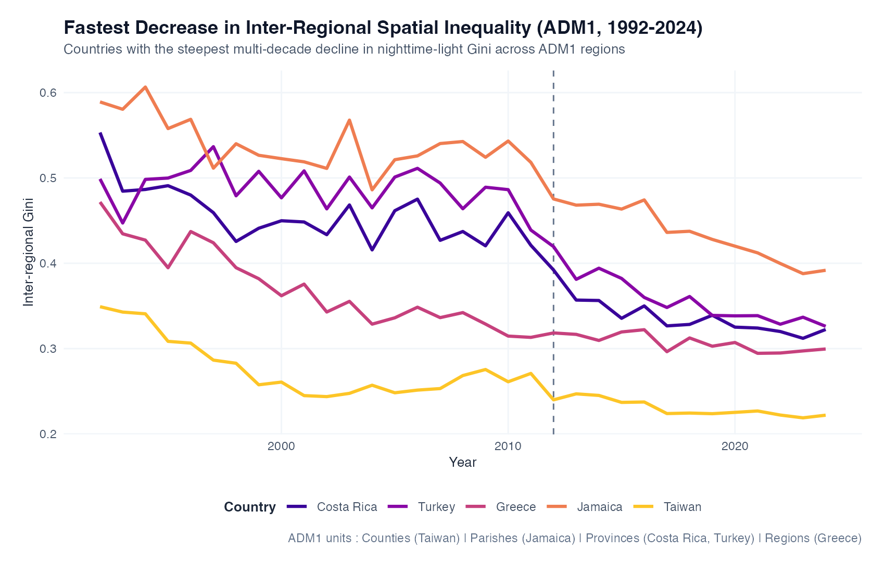
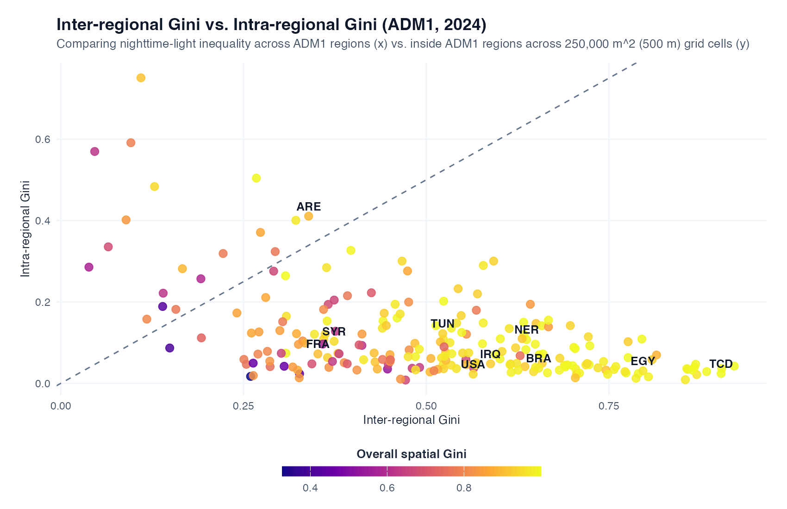
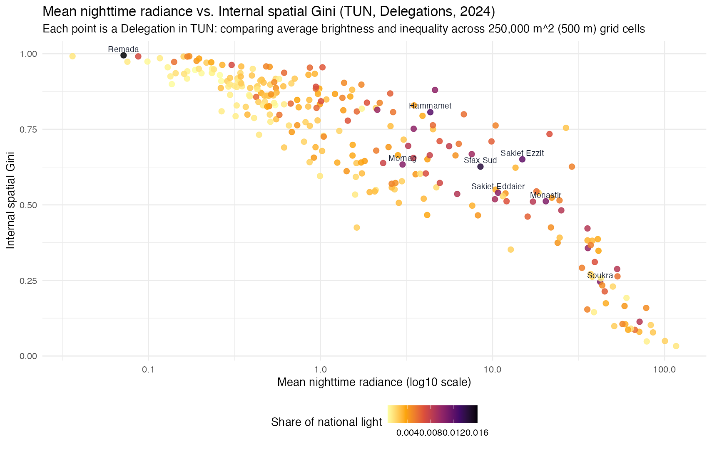
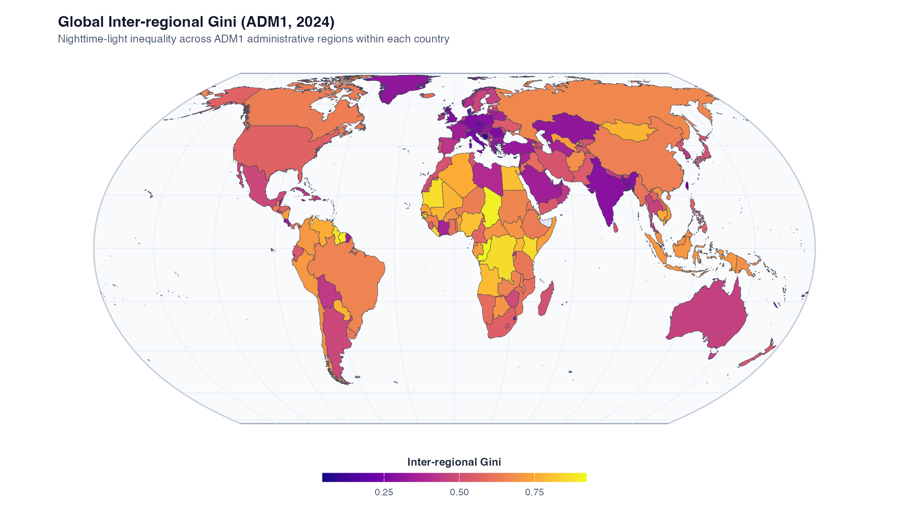
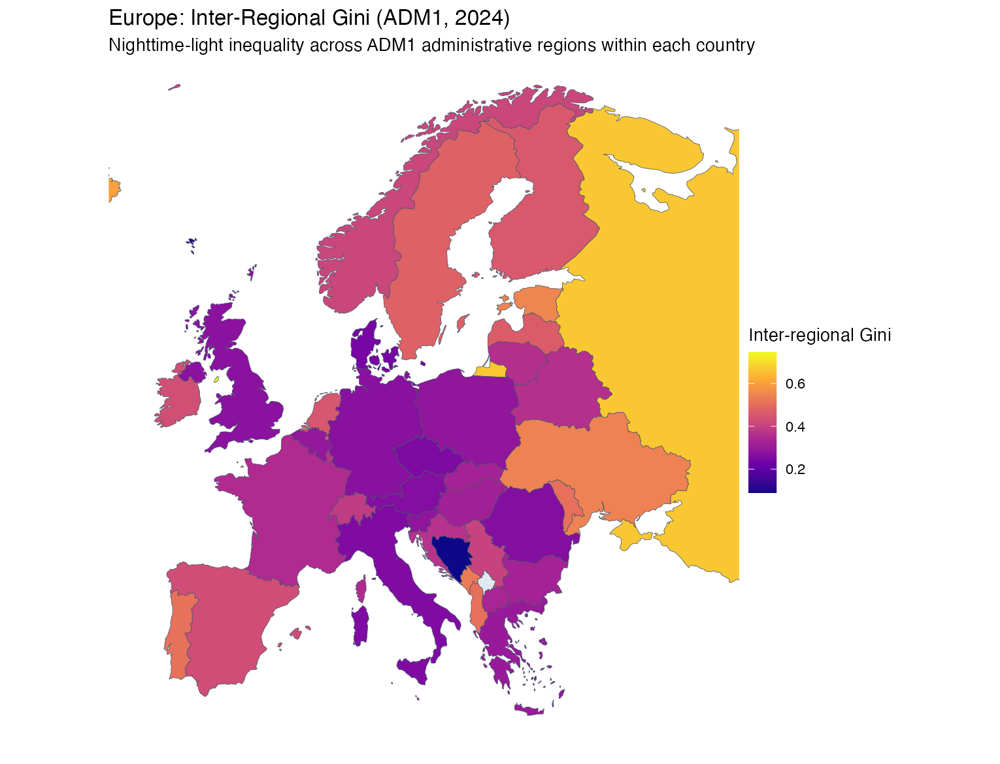
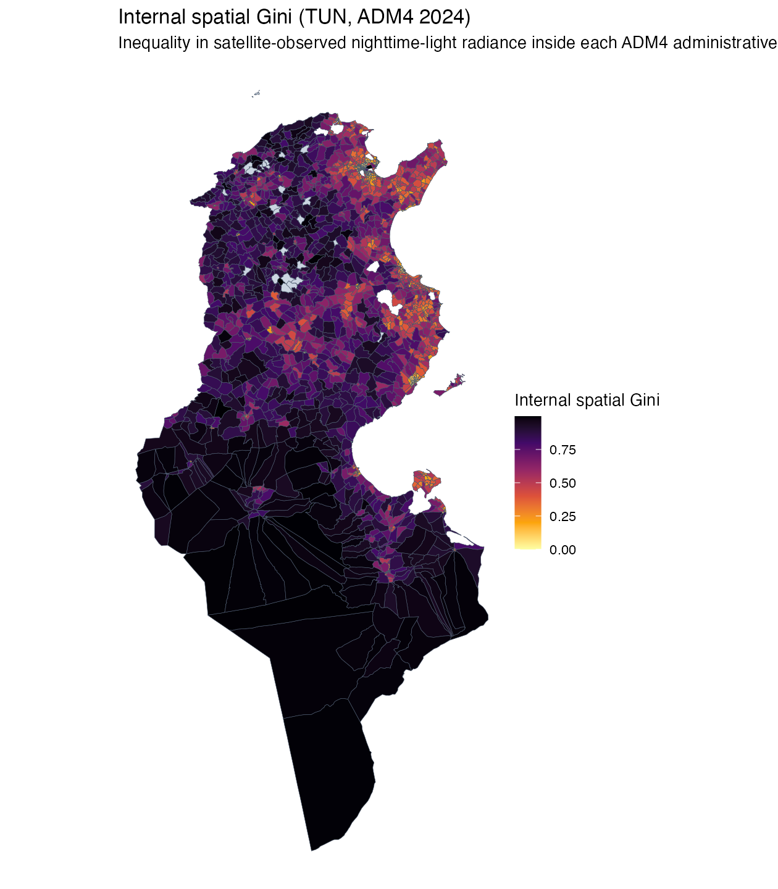

# ntlgini 

**Global Subnational Nighttime-Light Gini Evolution (1992–2024)**

[](https://github.com/MedDhia/NTLGini/actions/workflows/R-CMD-check.yaml)
[](https://github.com/MedDhia/NTLGini/actions/workflows/test-coverage.yaml)
[](https://lifecycle.r-lib.org/articles/stages.html#stable)
[](https://github.com/MedDhia/NTLGini/releases/tag/v0.1.0)
[](https://github.com/MedDhia/NTLGini/releases)
[](https://github.com/MedDhia/NTLGini/commits/main)
[](https://github.com/MedDhia/NTLGini/issues)
[](LICENSE)

`ntlgini` provides harmonized annual nighttime-light Gini coefficients and **Pyatt (1976) / Dagum (1997)** decompositions—splitting overall spatial inequality into **inter-regional**, **intra-regional**, and **cross-region overlap** components—across administrative levels (`ADM_1` through `ADM_4`) for **228 countries and territories** from **1992 to 2024**.

The dataset is derived from **Cheng et al. (2026)** 500 m × 500 m (`250,000 m²` grid cells) VIIRS-like nighttime lights ([*Earth System Science Data*](https://doi.org/10.5194/essd-18-3449-2026)) intersected with **GADM 4.1** administrative boundaries (`195` countries) and **HDX COD-AB** boundaries (`33` countries where HDX offers deeper administrative tiers).

---

## Installation

```r
# From GitHub
# install.packages("remotes")
remotes::install_github("MedDhia/NTLGini")

# Optional: for subunit-level Parquet tables (ntl_gini_units, ntl_gini_top_units)
install.packages("arrow")

# Optional: for built-in visualizations and shapefile maps
install.packages(c("ggplot2", "sf"))
```

---

## Data Coverage

Country-level decompositions (`ntl_gini_global`) and coverage metadata (`ntl_gini_countries`) are bundled directly in the package (`< 1 MB` total, zero external dependencies). Subunit-level Parquet tables are hosted on [GitHub Releases (`v0.1.0`)](https://github.com/MedDhia/NTLGini/releases/tag/v0.1.0) and downloaded on demand into `tools::R_user_dir("ntlgini", "cache")` using `arrow` predicate pushdown:

| Object / Function | Scope | Rows | Countries | Size |
|---|---|---:|---:|---:|
| `ntl_gini_global` / `ntl_gini_decomp()` | Country × year × level (`adm1`–`adm4`) | 17,553 | 228 | 0.80 MB (bundled) |
| `ntl_gini_countries` | Country metadata & max admin level | 228 | 228 | < 0.01 MB (bundled) |
| `ntl_gini_monthly()` | Monthly Gini & Theil (national & `ADM_1`) | 984 | Pilot / cached | 0.03 MB (bundled) |
| `ntl_gini_units("adm1")` | `ADM_1` subunits × year | 113,173 | 228 | 3.28 MB (cached) |
| `ntl_gini_units("adm2")` | `ADM_2` subunits × year | 1,502,072 | 183 | 43.36 MB (cached) |
| `ntl_gini_units("adm3")` | `ADM_3` subunits × year | 4,194,077 | 92 | 102.86 MB (cached) |
| `ntl_gini_units("adm4")` | `ADM_4` subunits × year | 7,418,928 | 29 | 136.35 MB (cached) |
| `ntl_raster()` / `ntl_extract()` | On-demand monthly/annual rasters & ROI zonal stats | Custom | Global (1992–2024) | On-demand / stream |

---

## Quick Start

### Country Coverage, Decompositions & Trends

```r
library(ntlgini)

# Check which countries have ADM_4 boundaries (29 countries)
subset(ntl_gini_countries, max_level == 4)

# Compare Tunisia and Morocco at ADM_1 and ADM_2 (2010-2024)
tun_mar <- ntl_gini_decomp(
  iso3 = c("TUN", "MAR"),
  level = c("adm1", "adm2"),
  years = 2010:2024
)

# Fit VIIRS-era (2012-2024) log-linear trends in inter-regional Gini
ntl_gini_trends(iso3 = c("TUN", "MAR"), level = "adm1", window = "viirs")
```

### Subunit Queries & Rankings (`arrow`)

```r
# Downloads and caches gini_by_unit_adm4.parquet on first call;
# filters to Tunisia in 2024 via Arrow Dataset Scanner pushdown (~0.06s)
tun_sectors <- ntl_gini_units(level = "adm4", iso3 = "TUN", years = 2024)

# Top 10 delegations contributing to Tunisia's intra-regional inequality in 2024
ntl_gini_top_units(level = "adm3", iso3 = "TUN", year = 2024, n = 10)
```

### Monthly Inequality & Raster Extraction (`terra` / `blackmarblepy`-style)

```r
# 1. Query monthly Gini and inequality series (national or ADM_1)
m_tun <- ntl_gini_monthly("Tunisia", level = "national", years = 2024)

# 2. Stream and crop remote monthly NTL rasters on demand (1992-2024)
# Fetches from Cheng et al. (2026) via GDAL VSI HTTP streaming without full downloads:
r_jan <- ntl_raster(country = "TUN", year = 2024, month = 1)

# 3. Extract zonal statistics and pixel Gini across custom polygon boundaries (mimics bm_extract)
# polygons is any sf object:
stats_monthly <- ntl_extract(polygons, year = 2024, month = 1:12, stat = c("sum", "mean", "gini"))
```

---

## Visualizations

### 1. Time-Series Comparisons (`ggplot2`)

Compare **inter-regional** or **intra-regional** inequality trajectories across countries (with country-specific administrative unit names automatically shown in the caption):

```r
# Inter-regional Gini at ADM_3 across Egypt, Iraq, Syria, and Tunisia (1992-2024)
ntl_gini_plot_series(c("EGY", "IRQ", "SYR", "TUN"), level = "adm3", metric = "between_gini")
```



```r
# Fastest increase in inter-regional spatial inequality across ADM_1 (1992-2024)
ntl_gini_plot_series(
  c("MDG", "SVK", "BLR", "BGD", "AGO"),
  level = "adm1", metric = "between_gini"
) +
  ggplot2::labs(
    title = "Fastest Increase in Inter-Regional Spatial Inequality (ADM1, 1992-2024)",
    subtitle = "Countries with the steepest multi-decade rise in nighttime-light Gini across ADM1 regions"
  )
```



```r
# Fastest decrease in inter-regional spatial inequality across ADM_1 (1992-2024)
ntl_gini_plot_series(
  c("CRI", "TUR", "GRC", "JAM", "TWN"),
  level = "adm1", metric = "between_gini"
) +
  ggplot2::labs(
    title = "Fastest Decrease in Inter-Regional Spatial Inequality (ADM1, 1992-2024)",
    subtitle = "Countries with the steepest multi-decade decline in nighttime-light Gini across ADM1 regions"
  )
```



### 2. Scatter Plots (`ggplot2`)

Explore cross-country decomposition trade-offs and subunit-level brightness vs. internal spatial inequality:

```r
# Inter-regional vs. intra-regional Gini across all countries at ADM_1 (2024)
ntl_gini_plot_scatter(
  level = "adm1", year = 2024,
  label_iso3 = c("TUN", "EGY", "SYR", "IRQ", "TCD", "NER", "ARE", "USA", "CHN", "FRA", "BRA")
)
```



```r
# Mean nighttime radiance vs. internal spatial Gini across Tunisia's Delegations (ADM_3, 2024)
ntl_gini_plot_unit_scatter(level = "adm3", iso3 = "TUN", year = 2024)
```



### 3. Choropleth Maps with Shapefiles (`sf` + `ggplot2`)

Pass any `sf` polygon object or path to a `.shp`, `.gpkg`, or `.geojson` file:

```r
# Global inter-regional Gini at ADM_1 in 2024 (Equal Earth projection, adopted by the UN)
ntl_gini_map_countries("path/to/world_countries.shp", level = "adm1", year = 2024, globe = TRUE)
```



```r
# Regional subset (Europe in ETRS89 / LAEA projection with background context)
ntl_gini_map_countries(europe_sf, level = "adm1", year = 2024, bg_sf = world_sf) +
  ggplot2::coord_sf(crs = 3035, xlim = c(2450000, 6200000), ylim = c(1350000, 5450000), expand = FALSE) +
  ggplot2::labs(title = "Europe: Inter-Regional Gini (ADM1, 2024)")
```



```r
# Subnational internal spatial Gini across Tunisia's 2,075 Sectors (ADM_4, 2024) with Governorate overlay
ntl_gini_map_units(
  "path/to/tun_adm4.gpkg", level = "adm4", iso3 = "TUN", year = 2024,
  overlay_sf = "path/to/tun_adm2.gpkg"
)
```



---

## Function Reference

| Category | Function | Purpose |
|---|---|---|
| **Data & Trends** | `ntl_gini_decomp()` | Filter bundled country-year Gini decompositions by `iso3`, `level`, and `years` |
| | `ntl_gini_trends()` | Fit log-linear `%/yr` trends & $R^2$ over `full` (1992–2024), `dmsp` (1992–2011), or `viirs` (2012–2024) |
| | `ntl_gini_units()` | Query subunit-level Parquet tables (`adm1`–`adm4`) with `arrow` pushdown filtering |
| | `ntl_gini_top_units()` | Rank top or bottom `n` subunits by `within_contribution`, `gini`, `mean_radiance`, or `value_share` |
| **Plots** | `ntl_gini_plot_series()` | Plot `total_gini`, `between_gini`, `within_gini`, and `overlap_gini` over time |
| | `ntl_gini_plot_decomp()` | Plot stacked area shares (`between_share`, `within_share`, `overlap_share`) |
| | `ntl_gini_plot_levels()` | Compare inter-regional Gini across all available `adm1`–`adm4` levels |
| | `ntl_gini_plot_scatter()` | Scatter plot comparing two Gini decomposition metrics across countries |
| | `ntl_gini_plot_unit_scatter()` | Scatter plot of subunit-level radiance vs. internal spatial Gini |
| | `ntl_gini_plot_top_units()` | Horizontal bar chart of top/bottom subunits from `ntl_gini_top_units()` |
| **Maps** | `ntl_gini_map_countries()` | Choropleth map of country-level decompositions from a world/regional shapefile |
| | `ntl_gini_map_units()` | Choropleth map of subunit-level Gini or radiance from a shapefile / `sf` object |
| **Cache** | `ntl_gini_cache_info()` / `ntl_gini_clear_cache()` | Inspect or clear locally cached `.parquet` files |

---

## Methodology & Data Dictionary

For each country $c$, year $t$, and administrative level $k \in \{\text{adm1}, \dots, \text{adm4}\}$, nighttime-light radiance across all `250,000 m²` (`500 m`) land grid cells is decomposed additively following Pyatt (1976) / Dagum (1997):

$$G_{\text{total}} = G_{\text{within}} + G_{\text{between}} + G_{\text{overlap}}$$

* **`within_gini` (Intra-regional Gini)**: $\sum_g p_g s_g G_g$, where $p_g$ is subunit $g$'s grid-cell share, $s_g$ is its light share, and $G_g$ is its internal spatial Gini.
* **`between_gini` (Inter-regional Gini)**: Grid-cell-weighted Gini across subunit mean radiances $\mu_g$.
* **`overlap_gini` (Cross-region overlap)**: Transvariation residual measuring distributional overlap across subunits.

### Methodological Notes
* **2011 → 2012 sensor transition:** Cheng et al. (2026) reconstruct 1992–2011 from DMSP-OLS (*NightNet*) and use native NPP-VIIRS from 2012 onward. While `sum_of_lights` and urban-core radiances are continuous, dim rural background grid cells (`0 < radiance < 0.5`) drop sharply in 2012. Use `ntl_gini_trends(..., window = "dmsp")` and `window = "viirs"` to verify robustness across eras.
* **Completely unlit subunits:** When every grid cell in a subunit is `0`, `gini` is `NA` (inequality is undefined) and its `within_contribution` is `0`.

---

## Citation & License

* **Package code:** MIT License (`LICENSE`). Run `citation("ntlgini")` in R for full BibTeX entries.
* **Underlying NTL dataset:** Cheng, H., Geng, M., Li, X., Li, S., Zhao, M., Lin, C., Wang, J., Gong, P., & Zhou, Y. (2026). A temporally consistent global 500 m-resolution monthly VIIRS-like nighttime light dataset (1992–2024). *Earth System Science Data*, 18, 3449–3479. https://doi.org/10.5194/essd-18-3449-2026 (CC BY 4.0).
