# Does nighttime-light spatial inequality predict political outcomes?

A robustness exercise linking `ntlgini` country-year Gini measures (1992–2024) to
cross-national political outcomes. All the outcome data come from political-science
R packages:

| Source (R package) | Outcomes used |
|---|---|
| **V-Dem v16** (`vdemdata`) | Urban–rural exclusion index and its components (power, public-service access, civil liberties); polyarchy; liberal democracy; political violence; mass mobilization; state authority over territory; corruption; rule of law; fiscal capacity; Powell & Thyne coup attempts |
| **`democracyData`** | Polity5 `polity2`; Freedom House (reversed total); Extended UDS; LIED lexical index |
| **`peacesciencer`** | UCDP/PRIO intrastate armed-conflict incidence and onset (1992–2024); CREG ethnic fractionalization; ruggedness (both used as controls) |
| **`WDI`** | Controls: log GDP pc (PPP), log population, % urban, resource rents |

**Panel:** 5,682 country-years, 173 V-Dem polities. The main specification uses
4,324 country-years from 148 countries.

## Bottom line

**Spatial inequality, as measured here, does not robustly predict political
outcomes once you account for how developed a country is.**

1. **Bivariate associations are strong and point the way theory expects.**
 also needs WDI electrification (cached by first run) More spatially unequal countries have more urban–rural political exclusion,
 also needs WDI electrification (cached by first run) less democracy, more conflict and political violence, more corruption, and
 also needs WDI electrification (cached by first run) weaker rule of law and fiscal capacity. 52 of 76 predictor × outcome pairs
 also needs WDI electrification (cached by first run) are significant (49 after Benjamini–Hochberg correction). The pattern holds
 also needs WDI electrification (cached by first run) on the main-spec sample too (47/76), so sample composition doesn't explain it.
2. **These associations go away with standard controls.** With controls plus
 also needs WDI electrification (cached by first run) year and region fixed effects, 3 of 76 pairs are p < .05 and **0 of 76 survive
 also needs WDI electrification (cached by first run) FDR correction**. Under the main specification **no pair counts as robust**
 also needs WDI electrification (cached by first run) (robust here means BH p < .05 in the main spec and same-sign p < .05 in at
 also needs WDI electrification (cached by first run) least 75% of the 10–12 non-bivariate specifications).
3. **The confounder is development.** Log GDP per capita on its own removes about
 also needs WDI electrification (cached by first run) 75% of the bivariate coefficient. The light Ginis correlate at −0.55 to −0.76
 also needs WDI electrification (cached by first run) with log GDP pc and mean radiance: poor countries have many unlit cells, and
 also needs WDI electrification (cached by first run) that mechanically pushes the Gini toward 1. Total Gini has a median of 0.96
 also needs WDI electrification (cached by first run) at ADM1.
4. **Adding the inequality measures does not improve prediction.** With 10×
 also needs WDI electrification (cached by first run) repeated, country-blocked 10-fold CV, adding all four measures to the control
 also needs WDI electrification (cached by first run) model *lowers* out-of-sample R² for 15 of 19 outcomes (median −0.018). The
 also needs WDI electrification (cached by first run) gains are tiny: conflict-incidence AUC +0.013, fiscal capacity R² +0.009, and
 also needs WDI electrification (cached by first run) territorial authority and exclusion each under +0.015.
5. **Within countries, nothing systematic shows up.** Country + year FE estimates
 also needs WDI electrification (cached by first run) are near zero and mixed in sign. Within-region (ADM1) Gini is the exception:
 also needs WDI electrification (cached by first run) it is negatively associated with every regime measure within countries
 also needs WDI electrification (cached by first run) (e.g., polyarchy −0.26 SD, p < .001). That result is not significant in the
 also needs WDI electrification (cached by first run) main pooled spec, though, and only 1 of 76 within-FE tests survives FDR.

### One lead worth pursuing: between-region Gini at **ADM2**

Measured across ADM2 rather than ADM1 units, between-region inequality is
negatively associated with **all six democracy measures**, even with the full
controls (≈ −0.18 SD per SD, BH p < .05 for all six). The follow-up checks
(`04_adm2_followup.R`) show:

- **It comes from the measure, not the sample.** ADM1 between-Gini on the same
 also needs WDI electrification (cached by first run)140 countries is null (≈ −0.05).
- It gets **stronger** when ADM1 between-Gini and total Gini are also controlled
 also needs WDI electrification (cached by first run)(≈ −0.30 to −0.41). The relevant variation is the inequality *across districts
 also needs WDI electrification (cached by first run)within provinces*.
- It holds up in the country-means cross-section (n = 140, ≈ −0.28), without
 also needs WDI electrification (cached by first run)region FE, when each of the six world regions is dropped in turn, and in a
 also needs WDI electrification (cached by first run)country jackknife (range −0.23 to −0.35).
- **It is zero within countries** (country + year FE ≈ 0).

So this is a persistent **cross-sectional** difference, not a dynamic predictor.
There is also a plausible artefact to rule out. ADM2 boundaries are political
objects: autocracies tend to proliferate and redraw districts, and GADM ADM2
granularity varies across countries. The unit-count control doesn't change the
result, but unit-*size* heterogeneity hasn't been addressed. A natural next step
is to recompute between-unit Gini on a regular grid or on population-equal
zones, which the subunit Parquet tables would allow.

### Other things to note

- **Total Gini → state authority over territory** is *positive* (+0.38 SD,
 also needs WDI electrification (cached by first run)BH p = .07, 7/10 specs), which is the opposite of the "harmful" hypothesis.
 also needs WDI electrification (cached by first run)The most likely cause is large, mostly empty but state-controlled territories
 also needs WDI electrification (cached by first run)such as deserts and the Gulf.
- **Within-region Gini → lower fiscal capacity** (−0.26 SD, BH p = .07, 7/12
 also needs WDI electrification (cached by first run)specs) is the closest any ADM1 measure comes to robustness.
- **There is a visible DMSP→VIIRS seam around 2012.** Germany's total Gini, for
 also needs WDI electrification (cached by first run)example, jumps from 0.72 to 0.84. Results are similar in DMSP-only and
 also needs WDI electrification (cached by first run)VIIRS-only subsamples and with country×era FE. Still, users of the package's
 also needs WDI electrification (cached by first run)within-country time series should be aware of it.

### Fixed-effects battery (`06_fixed_effects.R`)

This section asks whether within-country *changes* in spatial inequality track
political change. It runs 5 predictors (the four ADM1 measures plus ADM2
between-Gini) × 19 outcomes under 9 FE designs:

- F1: country + year FE, no controls
- F2: F1 plus time-varying controls (log GDP pc, log population, % urban, log mean radiance, resource rents)
- F3: region×year FE
- F4: country-specific linear trends
- F5: country×era FE
- F6 / F7: predictor lagged 3 / 5 years
- F8: placebo using inequality 3 years *in the future*
- F9: 5-year-period panel

| | F1 | F2 | F3 | F4 | F5 | F6 | F7 | F8 placebo | F9 |
|---|---|---|---|---|---|---|---|---|---|
| p < .05 (of 95) | 13 | 20 | 19 | 12 | 15 | 15 | 11 | 4 | 10 |
| BH-significant | 0 | 1 | 0 | 1 | 0 | 0 | 0 | 0 | 0 |

- **There is little within-country variation to use.** After country and year
 also needs WDI electrification (cached by first run)FE, only 1.4% (within-region Gini) to 9% (ADM2 between Gini) of each
 also needs WDI electrification (cached by first run)measure's variance is left. A large share of that residual likely reflects
 also needs WDI electrification (cached by first run)sensor noise and the 2012 seam rather than real redistribution of activity.
- **There is still enough power for moderate effects.** The median F2 SE is
 also needs WDI electrification (cached by first run)0.045 outcome-SD per pooled SD of inequality, so the minimum detectable effect
 also needs WDI electrification (cached by first run)at 80% power is ≈ 0.13. The nulls are not just noise.
- **The significant results don't point one way.** Of the 20 F2 hits, 8 are in
 also needs WDI electrification (cached by first run)the "inequality is harmful" direction and 12 go the other way.
- **The only BH-significant within-country result fails the identification
 also needs WDI electrification (cached by first run)checks.** Within-region Gini → lower polyarchy (−0.26 SD, BH p = .04) is
 also needs WDI electrification (cached by first run)stable across F1–F3, F5 and F9. But it vanishes with country trends
 also needs WDI electrification (cached by first run)(F4: −0.07), and the *future* value of inequality predicts current democracy
 also needs WDI electrification (cached by first run)about as well (F8: −0.21, p = .03). That pattern means slow co-moving trends
 also needs WDI electrification (cached by first run)(democratic erosion coinciding with secular lighting trends), not inequality
 also needs WDI electrification (cached by first run)preceding political change.
- **The coup associations fail the placebo too.** Future between-region
 also needs WDI electrification (cached by first run)inequality "predicts" today's coups (p ≈ .001), which points to reverse
 also needs WDI electrification (cached by first run)causation: political shocks change the light distribution.
- **No predictor × outcome pair is robust within countries.** Robust here means
 also needs WDI electrification (cached by first run)BH p < .05 in F2, same-sign p < .05 in at least 6 of the 7 non-placebo
 also needs WDI electrification (cached by first run)alternatives, and a null placebo.

### Reverse-direction test (`07_reverse_direction.R`)

The question here is whether regime change reshapes how light is distributed.
The prior is the democracy-and-electrification argument (Brown & Mobarak 2009;
Min 2015).

**A. Cross-lagged panel.** Both directions are estimated in the same FE models:
4 inequality measures × 5 democracy measures × horizons of 1, 3 and 5 years.
Effects are in within-country SD units, using the residual SDs after country
and year FE, so the two directions are comparable.

| Polyarchy × within-region Gini, k = 1 | Democracy → future inequality | Inequality → future democracy |
|---|---|---|
| TWFE + controls | −0.093 (p = .002) | −0.090 (p = .001) |
| + lagged dependent variable | −0.034 (p = .04) | −0.007 (p = .47) |
| + lagged DV + country trends | −0.008 (p = .57) | −0.018 (p = .21) |

- In plain TWFE the association is the same size in both directions. That is
 also needs WDI electrification (cached by first run)what a shared trend produces, not one variable driving the other.
- With a lagged dependent variable, a small democracy → inequality effect
 also needs WDI electrification (cached by first run)remains at one year only. It is no longer significant at 3 or 5 years.
- With country trends, both directions are null.
- Across all 20 measure pairs, the share of p < .05 results stays near chance
 also needs WDI electrification (cached by first run)in every variant and direction (0–6 of 20), and almost nothing survives BH.

**B. Event studies** (Sun & Abraham 2021 estimator; window −6 to +8; controls
include GDP pc, population, % urban and resource rents). Events are the first
sustained crossing of the Regimes of the World (RoW) democracy threshold in
1995–2021: 45 democratizations against 58 always-autocracies, and 32
breakdowns against 52 always-democracies. LIED transitions are used as a
robustness check (44 events).

- There are no pre-trends: the average t−6 to t−2 deviation has p > .1 for
 also needs WDI electrification (cached by first run)every outcome.
- **No distribution measure moves** after democratization or breakdown. For
 also needs WDI electrification (cached by first run)example, the ATT of RoW democratization on within-region Gini is −0.007
 also needs WDI electrification (cached by first run)(SE 0.017); for LIED it is −0.028 (SE 0.026).
- The design can rule out effects larger than about 0.4 within-country SD of
 also needs WDI electrification (cached by first run)within-region Gini.
- The only near-signal is a *level* effect: mean radiance rises after
 also needs WDI electrification (cached by first run)breakdowns (+0.064 log points, p = .07).

**C. Mechanism.** Polyarchy doesn't predict WDI rural electricity access 3 years
later (−0.24 pp, SE 0.67). Rural access doesn't predict within-region Gini, and
controlling for its change leaves the democracy coefficient unchanged. WDI
access figures are partly modelled and smoothed, so this is a weak test.

**Verdict.** Country-level regime change doesn't reshape the distribution of
light measured by these area-weighted Ginis, in either direction. The
within-country co-movement is best read as country-specific trends. The
electrification mechanism may still operate at a scale these measures can't
see, such as villages in competitive constituencies. Testing that needs
population-weighted or unit-level (ADM2/ADM3) outcomes matched to subnational
electoral data.

### Does democratization increase the *amount* of light? (`08_democracy_light_levels.R`)

This section is the light-based analogue of Acemoglu, Naidu, Restrepo &
Robinson (2019), with light in place of GDP. The event studies use the Sun &
Abraham estimator with no time-varying controls, because GDP is the mediator of
interest. Effects are in log points × 100 (≈ %). WDI GDP per capita is the
benchmark outcome.

| Event (RoW unless noted) | FE | Total light | Light per capita | GDP pc |
|---|---|---|---|---|
| Democratization | country + year | +3.9 (p = .33) | **+9.4 (p = .03)** | +2.5 (p = .36) |
| Democratization | + region×year | +0.8 (p = .85) | +3.9 (p = .38) | −2.5 (p = .40) |
| Democratization | + initial-income tercile×year | +2.9 (p = .55) | +7.3 (p = .15) | +2.2 (p = .44) |
| Democratization (LIED) | country + year | +2.7 (p = .65) | +6.4 (p = .31) | +0.3 (p = .93) |
| Breakdown | country + year | **+14.4 (p < .001)** | **+11.5 (p = .003)** | **+7.1 (p = .004)** |
| Breakdown | + region×year | **+11.2 (p = .003)** | +7.9 (p = .05) | +3.3 (p = .16) |
| Breakdown | + initial-income tercile×year | +11.4 (p = .06) | +12.6 (p = .05) | **+7.8 (p = .01)** |

- Pre-trends are flat in every variant (all p > .05).
- Dropping events in 2009–2015, around the sensor switch, gives the same results.
- **ANRR-style dynamic panel** (4 lags, country + year FE): the long-run effect
  of democracy on light is +5.5 to +13% (SE 5–10, p = .10–.36). The same model
  on WDI GDP in this 1992–2024 window is null (−9 to +6%). ANRR's ≈ 20% GDP
  effect doesn't reproduce in this short, post-1992 window.
- The 5-year light–GDP elasticity is 0.55 (SE 0.12). An ANRR-sized GDP effect
  would therefore show up as roughly +11% in light, which lies inside every
  confidence interval above.

**Verdict.**
- Democratization effects on light are positive in every specification, but
  small and not robust. The one significant estimate (+9.4% light per capita)
  is about halved and loses significance once comparisons are limited to
  countries in the same region. The data can't rule out an effect of ANRR's
  size, but they don't show one.
- **Light rises after democratic breakdowns** (+11–14% total light). This
  survives region-by-year comparisons and has flat pre-trends. Part of it
  follows GDP. Part (+11% light vs. +3% GDP within region) may reflect
  autocracies investing in visible infrastructure, or a breakdown sample
  concentrated in growing middle-income countries. It is a descriptive puzzle,
  not an established effect.

### What happens to light after democratic breakdowns? (`09_breakdown_deep_dive.R`, `10_breakdown_figure.R`)

The events are 32 first, sustained RoW crossings from democracy to autocracy in
1995–2021, compared with 37 always-democracies. All estimates use the Sun &
Abraham estimator with country + region×year FE. 28 of the 32 events are
incumbent-led erosions (e.g., Turkey 2013, Hungary 2018, India 2017, Serbia
2014, Nicaragua 2007, El Salvador 2021). Only 4 have a coup within a year
(Niger 1996, Fiji 2000, Thailand 2006, Honduras 2009).

Caterpillar plots (one series each, point estimate + 95% CI per event year, in `output/figures/`):

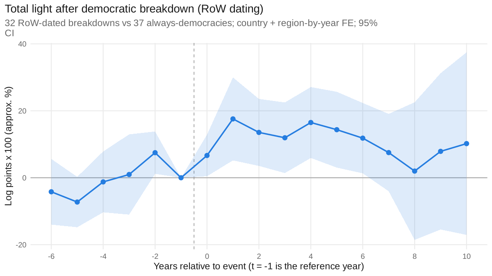
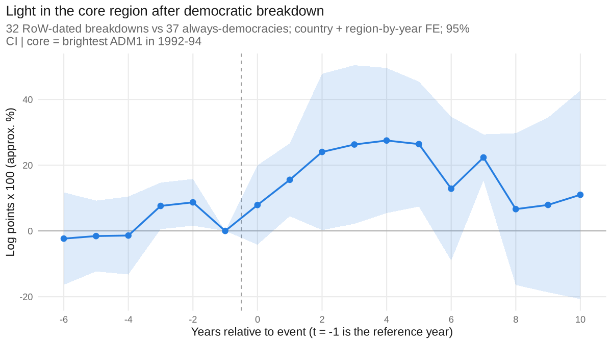
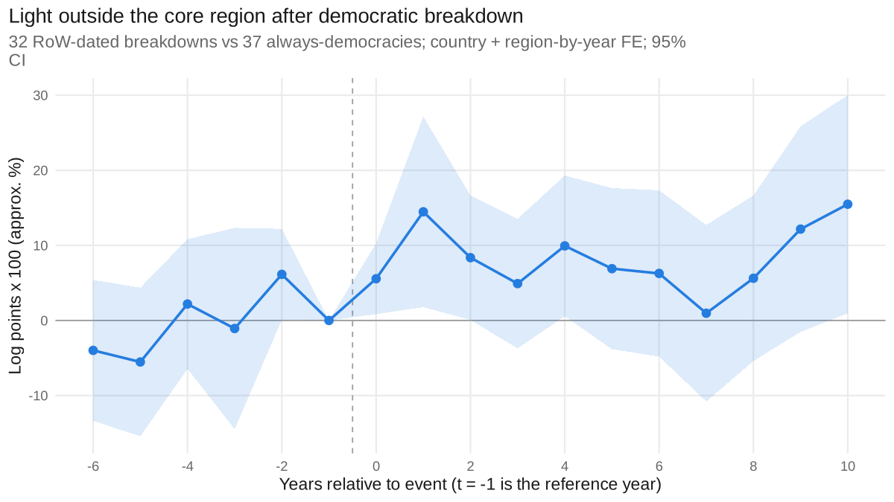
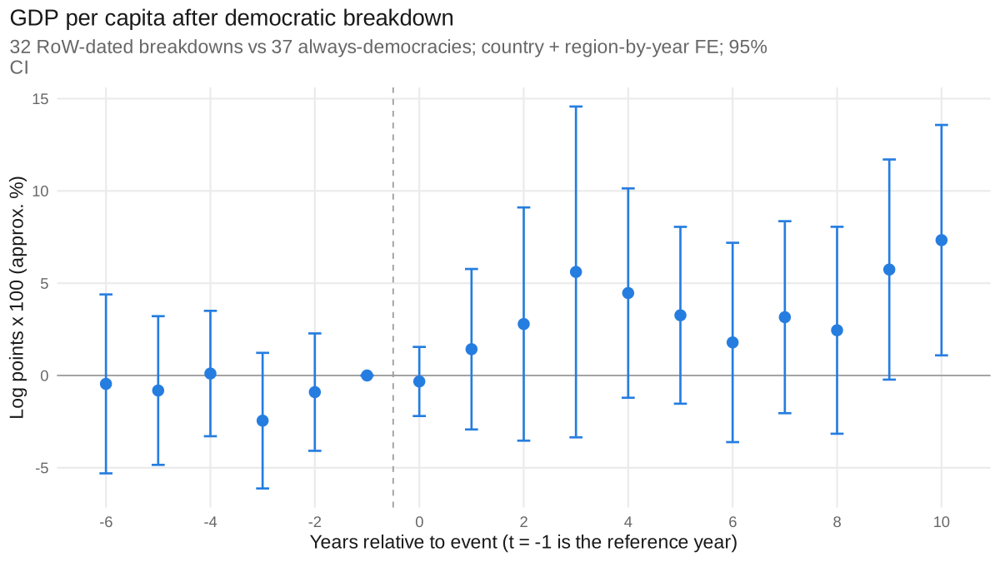
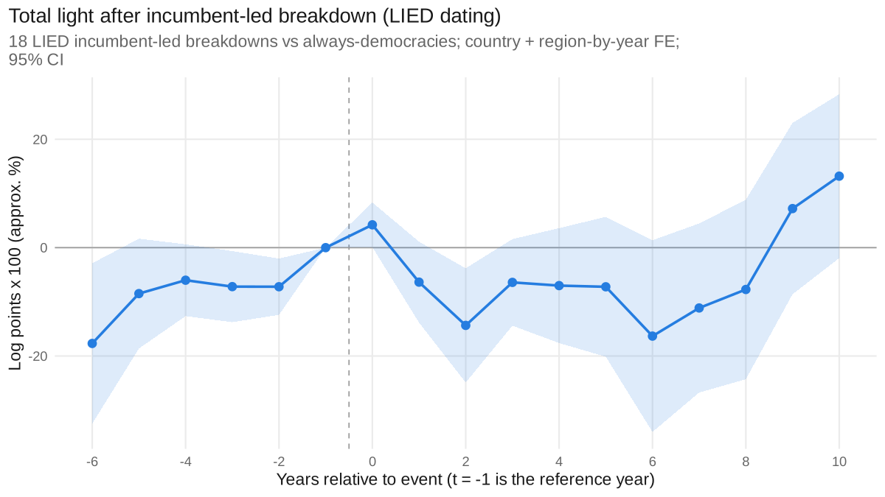
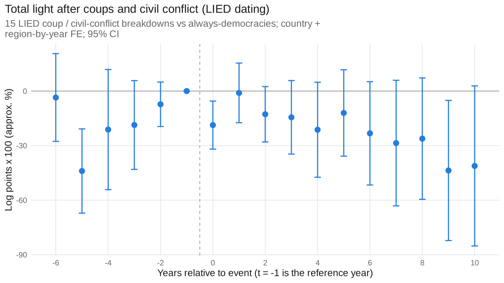

**After RoW-dated breakdowns, light rises and concentrates in the core region.**

| Outcome (region×year FE) | ATT | p | Pre-trend p |
|---|---|---|---|
| Total light | +11.2% | < .001 | .85 |
| GDP per capita | +3.3% | .16 | .60 |
| Light per capita minus GDP per capita | +5.3% | .09 | .60 |
| Light in core region (brightest ADM1 in 1992–94) | **+17.5%** | < .001 | .56 |
| Light outside the core | +8.2% | .04 | .94 |
| Core region's share of national light | **+1.6 pp** | .02 | .59 |

- **Timing.** Light starts rising around t−2 and peaks at t+1. Core-region light
  stays 24–27% above baseline in years +2 to +5, then fades back by years
  +6 to +8.
- **Influence.** Dropping one country at a time leaves the ATT between +8.1%
  and +13.8%, and it stays significant at p < .10 in every case.
- **Not oil.** The effect comes from low-rent breakdowns (rents < 5% of GDP:
  +16.2%, p < .001). High-rent cases go the other way (−9.2%, p = .17).
  Excluding Guyana, Libya and Palestine gives +10.8% (p < .001).
- **Incumbent-led.** Incumbent-led erosions give +11.8% (p < .001). There are
  too few coup-led RoW cases (4) to say anything about them.
- **Concentrated in recent cases.** VIIRS-era events (2012–2021) give +21.1%
  (p = .06); DMSP-era events give +6.7% (p = .28).

**The result depends on how breakdowns are defined and dated.**

| Definition | Total light ATT | p | Pre-trend p |
|---|---|---|---|
| LIED, all breakdowns (33) | −9.0% | .18 | .02 |
| LIED, coups & civil conflict (15) | **−21.5%** | .08 | .08 |
| LIED, incumbent-led (18) | −5.4% | .20 | .02 |

- **Coups and civil conflict dim the lights**, which is what you'd expect from
  economic disruption.
- **LIED incumbent-led breakdowns show light rising *before* the event date.**
  For incumbent-led cases in both datasets, LIED dates the breakdown a median
  **3 years later** than RoW (Turkey +5, Serbia +6, Nicaragua +9, Venezuela +6,
  Sri Lanka +5). RoW marks the early phase of erosion. LIED marks the later loss
  of competitive elections, by which time the rise in light has already
  happened. That reconciles the two series, but it also shows the result is a
  feature of the **early phase of executive aggrandizement**, not of breakdowns
  in general.

**Interpretation.** Elected incumbents eroding democracy preside over a
temporary burst of light, concentrated in the core region. The rise is larger
than GDP growth would predict. Three readings fit the pattern; none is tested
here:
1. Visible infrastructure and urban lighting as performance legitimation in the
   regime's core.
2. Spending booms ahead of consolidation (cf. political budget cycles).
3. Selection: incumbents who can erode democracy tend to be ones presiding over
   booms.

Two tests would discriminate: event-time public investment or energy data, and
light in the leader's home region versus the capital region.

### Spatial distribution of light after democratization and autocratization (`11_spatial_distribution_events.R`)

The same event designs as above are run symmetrically on four event sets: RoW
democratization (45, vs always-autocracies), RoW autocratization (32, vs
always-democracies), and LIED transitions and breakdowns (44 / 33). They use
the Sun & Abraham estimator with country + region×year FE and no time-varying
controls.

**Country level.** Gini measures are in Gini points × 100. Shares are each
country's light in its baseline-brightest ADM1 (core) or in its darkest third
of ADM1 regions (by 1992–94 radiance).

| Outcome | Democratization RoW | Autocratization RoW | Democratization LIED | Autocratization LIED |
|---|---|---|---|---|
| Total Gini (base ≈ 95) | −0.36 (p = .02) | −0.22 (.24) | −0.29 (.16) | +0.72 (.07) |
| Between-region Gini ADM1 | −0.80 (.32) | −0.35 (.64) | −0.28 (.75) | −1.48 (.27) |
| Within-region Gini ADM1 | +0.03 (.87) | −0.09 (.51) | −0.22 (.43) | +0.53 (.28) |
| Between-region Gini ADM2 | −0.73 (.26) | −0.56 (.30)† | −0.35 (.66) | −0.45 (.67) |
| Core-region share (pp) | +0.54 (.63) | **+1.66 (.02)**; years 5–9: +2.0 (.02) | +1.41 (.23) | +0.32 (.86) |
| Darkest-third share (pp) | −0.11 (.84) | −1.25 (.01)† | 0.00 (1.0) | −2.53 (< .001)† |

† marks a pre-trend at p < .05. The event-time paths show that both negative
dark-share estimates come from the reference year: the share sits 1–2.5 pp
below its t−1 level both before and after the event, with no break at the event.

**ADM1-unit triple difference.** The outcome is log light of each ADM1 unit
(1,183–1,735 units). FE are unit, country×year (absorbing every national shock,
including growth) and baseline-tercile×year (absorbing global convergence of
dark regions). The bright tercile is the reference. Estimates for dark regions
relative to bright ones:

| | Pre (−6..−2) | Early (0..4) | Late (5..10) |
|---|---|---|---|
| Democratization RoW | −2.4 (.56) | +5.0 (.48) | +7.9 (.47) |
| Autocratization RoW | −4.7 (.15) | +3.6 (.27) | +11.3 (.13) |
| Democratization LIED | −3.1 (.55) | +4.2 (.43) | +16.8 (.13) |
| Autocratization LIED | **−13.1 (< .001)** | +1.7 (.71) | +7.6 (.44) |

Dark regions keep catching up after *both* kinds of regime change. The pre-period
coefficients point the same way: dark regions were already gaining relative to
the reference year. That pattern is an ongoing convergence trend in treated
countries, not a break caused by the regime change.

**Verdict.**
- Neither democratization nor autocratization detectably redistributes light
  toward or away from the periphery. Gini changes are below 1 Gini point, and the
  one significant estimate is −0.36 points against a base of 95.
- The only clean distributional signal is a **temporary concentration of light
  in the core region after RoW-dated (incumbent-led) autocratization**. The
  core share rises ≈ 3 pp in years 3–7, then returns to baseline, with flat
  pre-trends. This matches the breakdown deep dive. It doesn't appear under
  LIED dating, consistent with LIED dating those events later.

### Civil wars and revolutions (`12_war_revolution.R`, `13_war_revolution_figure.R`)

**Events.** First qualifying event per country, 1995–2021:
- Civil-conflict onset (UCDP/PRIO via `peacesciencer`, ≥ 25 battle deaths, after ≥ 3 conflict-free years): 48 events.
- Civil-war onset (≥ 1,000 deaths): 18.
- Conflict termination (≥ 3 years of peace after ≥ 2 conflict years): 32.
- Revolution by popular uprising (V-Dem `v2regendtype` = 8; event = first year of the successor regime): 11. These are Indonesia 1998, Georgia 2003, Haiti 2004, Kyrgyzstan 2005, Lebanon 2005, Ukraine 2005, Nepal 2006, Egypt 2011, Tunisia 2011, Burkina Faso 2014 and Armenia 2018.
- Armed revolution (regime lost a civil war, `v2regendtype` = 5): 12.
- Leader ousted by popular protest (Archigos, through 2015), as a robustness check: 9.

Comparison groups are never-conflict countries (1989–2024) for the conflict
events and countries with no regime change for the revolutions. All estimates
use the Sun & Abraham estimator with country + region×year FE and no
time-varying controls. The event list is in `war_revolution_events.csv`.

Caterpillar plots (one series each, point estimate + 95% CI per event year, in `output/figures/`):

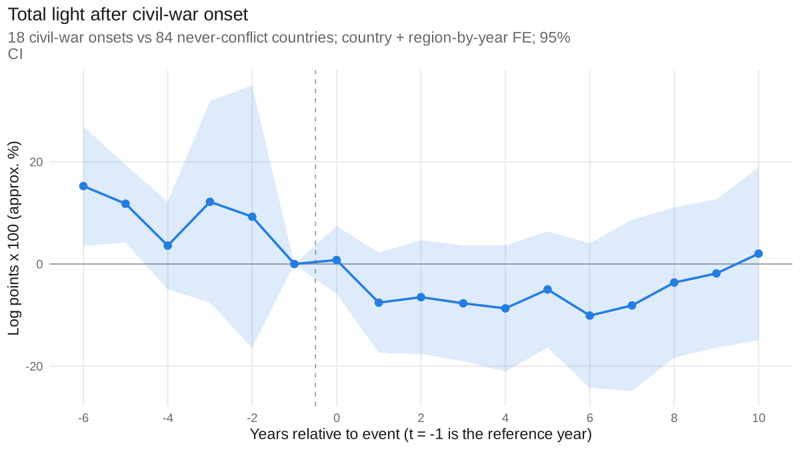
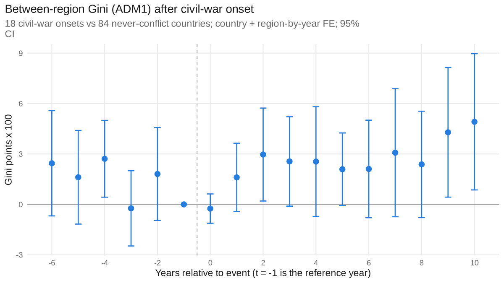
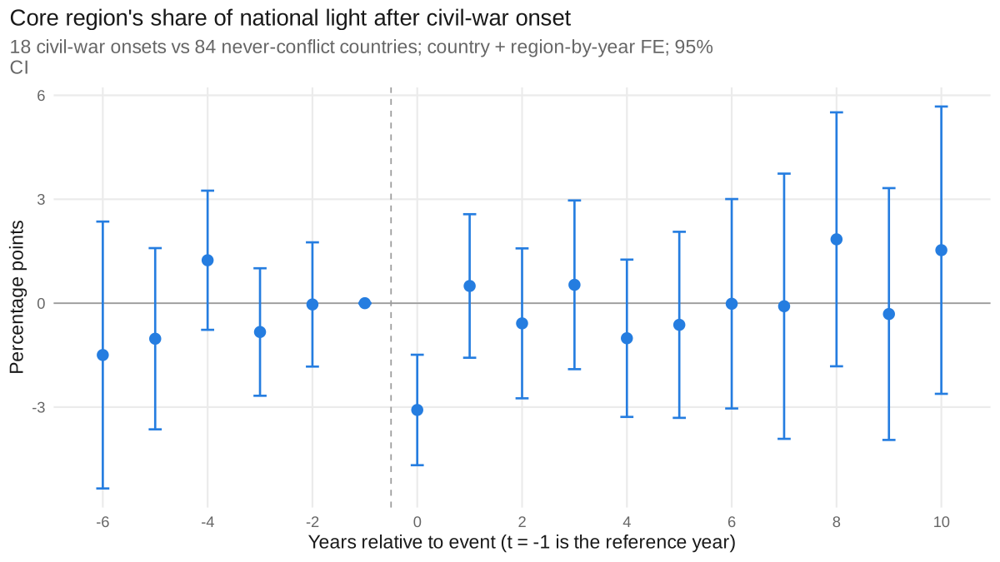
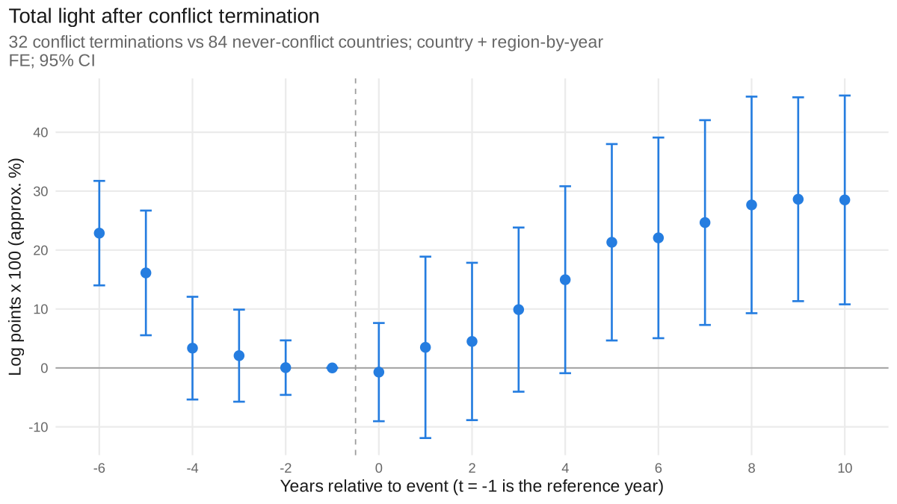
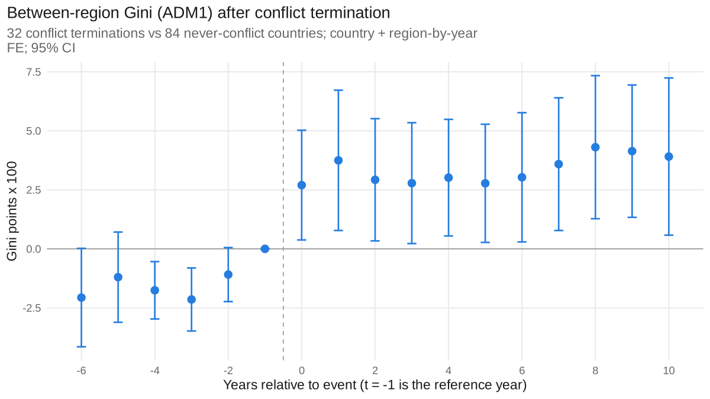
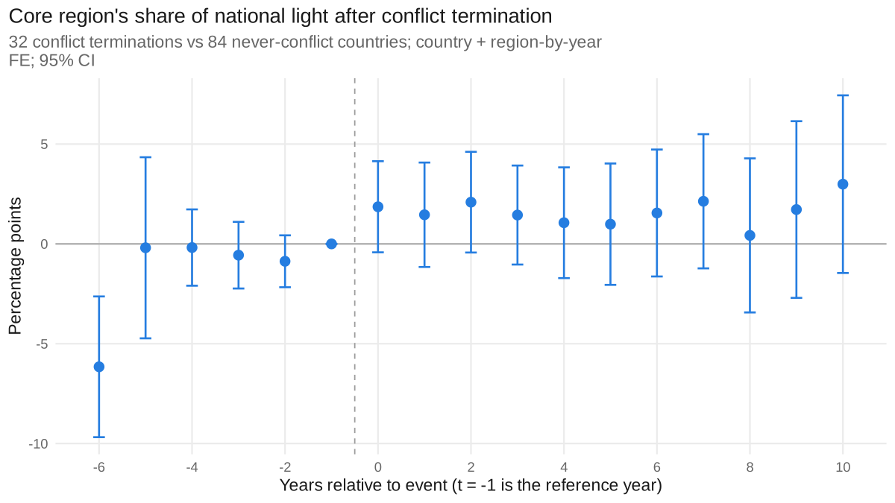
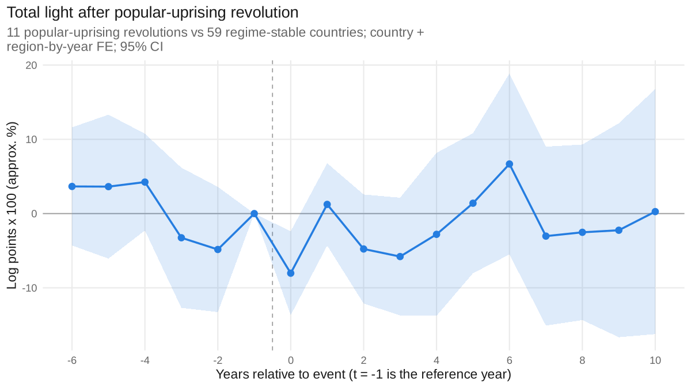
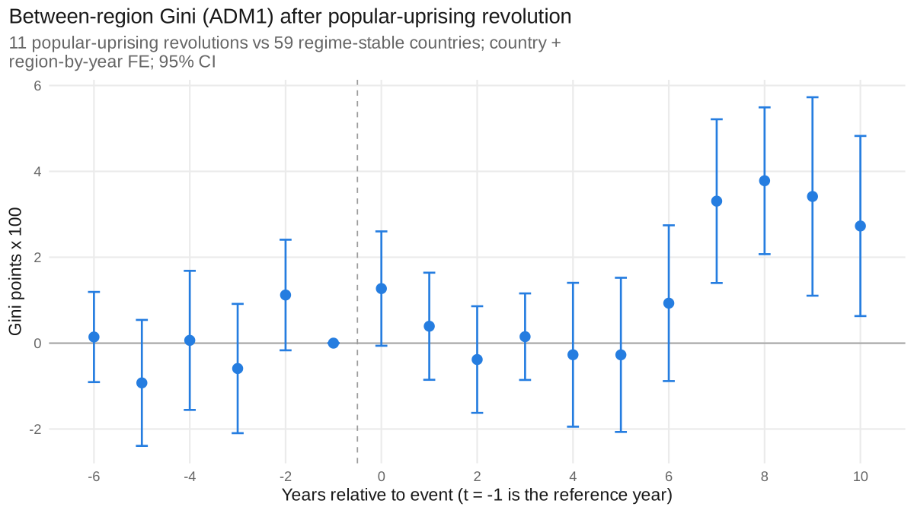
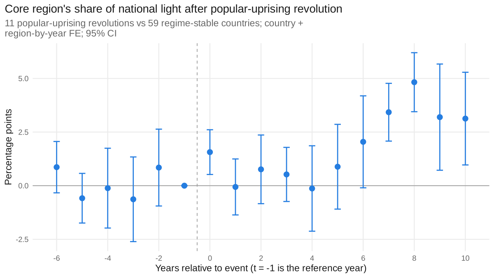

| Event | Total light | GDP pc | Between-region Gini ADM1 | Core-region share |
|---|---|---|---|---|
| Civil-conflict onset (48) | +1.3% (.79) | −1.6% (.53) | +0.6 (.43) | +0.9 pp (.36) |
| Civil-war onset (18) | −5.2% (.39); years 1–7 ≈ −8% | years 0–4: −5.1% (.02) | +2.6 (.07) | −0.1 pp (.92) |
| **Conflict termination (32)** | **+16.3% (.03); years 5–9: +24.8% (< .001)** | +6.3% (.07) | **+3.3 (.01)** | +1.6 pp (.28) |
| **Popular-uprising revolution (11)** | −1.8% (.69) | −0.2% (.95) | +1.3 (.05); years 5–9: +2.2 (.01) | **+1.8 pp (.01); years 5–9: +2.8 pp (< .01)** |
| Armed revolution (12) | +14.6% (.23)† | −9.6% (.20) | +2.2 (.13) | −1.3 pp (.53)† |
| Protest ouster, Archigos (9) | +2.2% (.77)† | −2.6% (.58) | +3.3 (.27) | −0.4 pp (.90) |

† marks a pre-trend at p < .05.

- **Minor conflict onsets do nothing detectable** to light or its distribution.
- **Civil wars dim the lights, but this isn't robust.** Light falls about 8%
  in the years after war onset, and the decline starts during the escalation
  before the war threshold. Core-region light falls most (−16% to −35%, very
  imprecise). GDP falls 5–7% in years 1–3. Dropping one country at a time, the
  light estimate ranges from −9% to +2%, is never significant, and is driven by
  Syria. Between-region inequality creeps up through the war (+2 to +5 Gini
  points by year 10).
- **The end of conflict brings a large, uneven recovery.** This is the
  strongest result in this section. Light falls through the final conflict
  years (the pre-period estimates are the war's damage, not a parallel-trends
  failure), then recovers steadily to about +28% by years 8–10. GDP recovers
  roughly half as much (+6 to +13%).
  - The recovery is spatially uneven. Between-region Gini jumps about 5 points
    around the end of the conflict, from −2 before to +3 after, and stays up.
  - Both checks hold: dropping any one country leaves the light ATT between +13%
    and +23% (late effect +22% to +32%, always p < .05). Between-region Gini
    stays between +1.9 and +3.8, always p < .05.
- **Popular revolutions concentrate light in the core, with a lag.** Total light
  dips about 8% in the revolution year, mostly outside the core (−11.5%), then
  returns to baseline. The core region's share is flat for about 5 years, then
  rises 3–5 pp in years 7–10. Between-region Gini rises 3–4 points over the same
  window. There are no pre-trends.
  - Dropping one country at a time, the late core-share effect stays between
    +1.7 and +3.5 pp, significant in 91% of drops. Haiti is the most influential
    case.
  - Caveats: there are only 11 events, the late years are identified mainly from
    the pre-2011 cohorts, and the Archigos protest-ouster events don't replicate
    the pattern.
  - Interpretation: post-revolutionary governments (mostly capital-based
    uprisings) may favor the capital region. This echoes the urban-bias account
    of regime survival (Ades & Glaeser 1995; Wallace 2014).
- **Armed revolutions can't be interpreted.** They come after civil wars, so the
  pre-trends are severe.

### Screen: which political events move the spatial distribution of light? (`14_event_screen.R`, `15_screen_figures.R`)

**Design.** 16 event types, each with its first qualifying event per country in
1995–2021. All use the same estimator (Sun & Abraham, country + region×year FE,
no controls, window −6 to +10) on six spatial measures: total, between-ADM1,
within-ADM1 and between-ADM2 Gini, core-region share, and darkest-third share.
The new event types are:
- successful coups (Powell & Thyne, via V-Dem);
- failed coup attempts;
- first-ever electoral turnover (LIED);
- introduction of elected regional or local government (V-Dem `v2elsrgel` / `v2ellocelc` crossing from not elected to elected);
- mass-mobilization surges (`v2cagenmob` entering the top 5%);
- repression surges (a fall of ≥ 0.15 in the physical-integrity index).

They join the regime-change, war and revolution events from the sections above.
Election cycles (repeated events) are estimated separately as distributed
leads and lags of national election years.

**Selection rule.**
- *Significant:* BH q < .05 across all 192 tests (16 events × 6 outcomes × {ATT years 0–10, years 5–9}), a pre-trend p > .10, and p < .05 in ≥ 80% of drop-one-country re-estimates.
- *Suggestive:* the same, with q < .10.

**Results.**
- 28 of 192 tests have p < .05 (about 10 would be expected by chance). Only 2
  have q < .05, and both have pre-trends: repression surges → core share, and
  LIED autocratization → darkest-third share.
- **No event passes the strict rule.**
- **Three pass the suggestive rule.** All are effects that build up over years
  5–9:

| Event | Outcome | Years 5–9 | BH q | Pre-trend p | Drop-one-country, share p < .05 |
|---|---|---|---|---|---|
| Failed coup attempt (30) | Between-region Gini ADM1 | +3.9 Gini points | .07 | .64 | 100% |
| Failed coup attempt (30) | Core-region share | +3.5 pp | .08 | .30 | 100% |
| Popular-uprising revolution (11) | Core-region share | +2.8 pp | .07 | .91 | 91% |

- **There is a consistent direction across event types,** though no single type
  clears the strict bar. In the core-share caterpillar plot, the events with the
  largest positive years 5–9 effects are all irregular seizures or uses of power:
  repression surges (+5.0, with a pre-trend), successful coups (+4.6, p = .02),
  failed coups (+3.5), popular revolutions (+2.8) and RoW autocratization
  (+2.0, p = .02). Introducing elected regional or local government points the
  other way (−0.6, −1.2; both n.s.).
- A plausible reading is that regimes facing a threat to their hold on power
  (a coup attempt, an uprising, a crackdown) concentrate resources in the core.
  This is consistent with coup-proofing and urban-bias accounts. Taken one at a
  time, each is suggestive, not established.
- **Election cycles** show no effect on any spatial measure, in competitive or
  non-competitive regimes (no lead/lag coefficient has q < .10).

**Figures** (caterpillar plots, one per file in `output/figures/`):
- Overview of all 16 event types for each spatial measure and window:
  `screen_<outcome>_att.png`, `screen_<outcome>_years5_9.png`
  (12 plots; filled = passes the suggestive rule, + = pre-trend).
- Year-by-year paths for the three suggestive results:

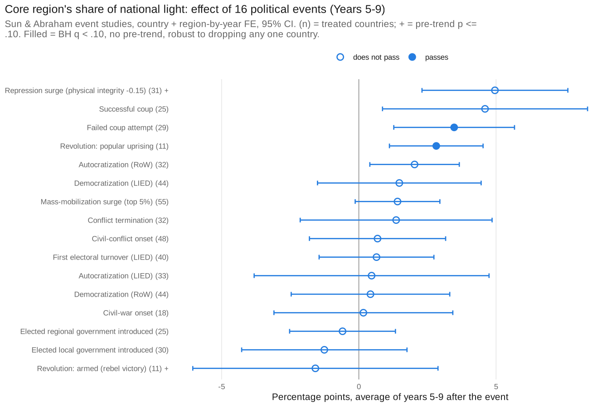
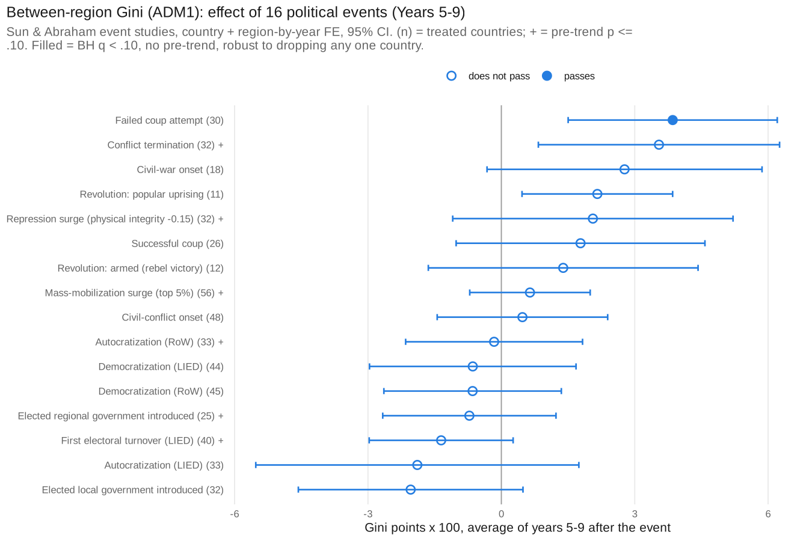
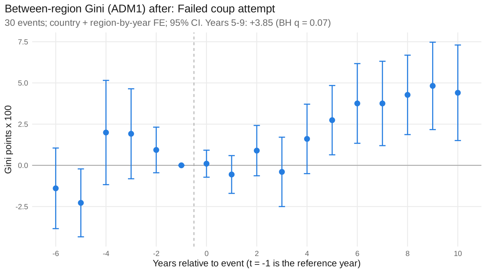
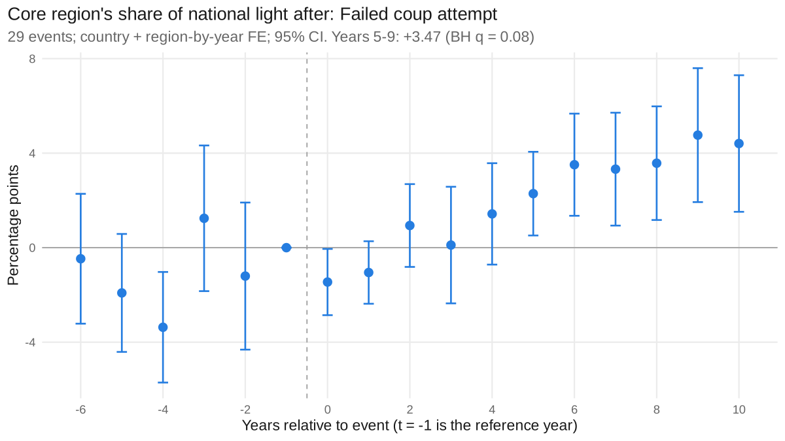
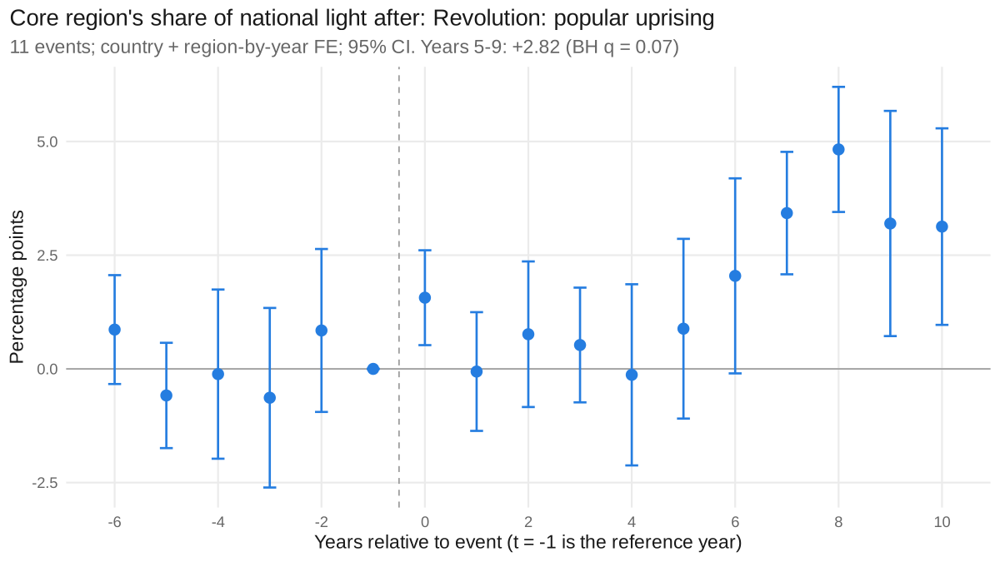


## Specification grid (`02_models.R`)

Predictors (each standardized; one predictor per model): total Gini; ADM1
between-region Gini; ADM1 within-region Gini; ADM1 between share. Continuous
outcomes are standardized. Binary outcomes are linear probability models.
SEs are clustered by country.

| ID | Specification |
|---|---|
| S01 / S01b | Bivariate + year FE (full sample / main-spec sample) |
| **S02** | **Controls + year & region FE (main)**: log GDP pc, log pop, % urban, log mean radiance, resource rents, log land area, log # ADM1 units, ethnic fractionalization, ruggedness |
| S03 | S02 without the mean-radiance control |
| S04 | S02 with predictor lagged 3 years |
| S05 | Outcome at t+3, conditional on outcome at t |
| S06 | Between-country: country means, region FE, HC1 SEs |
| S07 | Country + year FE (time-varying controls) |
| S08 | Country×era + year FE (absorbs the DMSP/VIIRS seam) |
| S09 / S10 | S02 in DMSP era (1992–2012) / VIIRS era (2013–2024) |
| S11 | S02 excluding states < 20,000 km² or with < 5 ADM1 units |
| S12 | S02 with ADM2-level measures (ADM2 unit count control) |
| S13 | ADM2-level measures, country + year FE |

## Reproduce

From the package root (requires `fixest`, `dplyr`, `tidyr`, `countrycode`,
`peacesciencer`, `WDI`, `ggplot2`, and `ntlgini` installed):

```sh
Rscript analysis/spatial-inequality-politics/00_get_data.R also needs WDI electrification (cached by first run)   # downloads V-Dem, democracyData .rda files, WDI
Rscript analysis/spatial-inequality-politics/01_build_panel.R
Rscript analysis/spatial-inequality-politics/02_models.R
Rscript analysis/spatial-inequality-politics/03_diagnostics.R also needs WDI electrification (cached by first run)# attenuation + cross-validation (~2 min)
Rscript analysis/spatial-inequality-politics/04_adm2_followup.R
Rscript analysis/spatial-inequality-politics/05_figures.R
Rscript analysis/spatial-inequality-politics/06_fixed_effects.R
Rscript analysis/spatial-inequality-politics/07_reverse_direction.R
Rscript analysis/spatial-inequality-politics/08_democracy_light_levels.R
Rscript analysis/spatial-inequality-politics/09_breakdown_deep_dive.R   # downloads the ADM1 unit table via ntl_gini_units()
Rscript analysis/spatial-inequality-politics/10_breakdown_figure.R
Rscript analysis/spatial-inequality-politics/11_spatial_distribution_events.R
Rscript analysis/spatial-inequality-politics/12_war_revolution.R            # ~3 min incl. jackknife
Rscript analysis/spatial-inequality-politics/13_war_revolution_figure.R
Rscript analysis/spatial-inequality-politics/14_event_screen.R              # ~1 min
Rscript analysis/spatial-inequality-politics/15_screen_figures.R
```

`vdemdata` and `democracyData` are GitHub-only packages. `00_get_data.R` fetches
only their bundled data files at pinned commits (V-Dem v16 `f4dd269`,
democracyData `84290a7`), so neither package needs to be installed.

## Outputs (`output/`)

- `spec_grid.csv`: every estimate (spec × predictor × outcome) with SE, p, BH/Holm p, N, clusters
- `robustness_summary.csv`: per predictor × outcome robustness tally
- `attenuation.csv`: bivariate coefficient after adding each control one at a time
- `cv_prediction.csv`: country-blocked CV, out-of-sample R² / AUC with and without the inequality measures
- `adm2_followup.csv`, `adm2_leave_one_region_out.csv`, `adm2_jackknife.csv`
- `fe_battery.csv`, `fe_robustness_summary.csv`, `fe_within_variation.csv`: fixed-effects battery
- `reverse_crosslag.csv`, `reverse_event_study.csv`, `reverse_events.csv`, `reverse_mechanism.csv`, `reverse_within_sd.csv`: reverse-direction tests
- `levels_event_study.csv`, `levels_anrr_dynamic_panel.csv`, `levels_light_gdp_elasticity.csv`: democracy and light levels
- `breakdown_events.csv`, `breakdown_events_lied.csv`, `breakdown_paths.csv`, `breakdown_jackknife.csv`, `breakdown_heterogeneity.csv`, `breakdown_heterogeneity_paths.csv`: breakdown deep dive
- `spatial_events_country.csv`, `spatial_events_unit_ddd.csv`: spatial distribution after regime change
- `war_revolution_events.csv`, `war_revolution_event_study.csv`, `war_revolution_jackknife.csv`: civil wars and revolutions
- `figures/`: one event-time caterpillar plot per event × outcome (breakdown_*, war_*, termination_*, revolution_*)
- `screen_events.csv`, `screen_paths.csv`, `screen_summary.csv`, `screen_tests.csv`, `screen_election_cycles.csv`: event screen
- `predictor_correlations.csv`, `coefplot.png`
