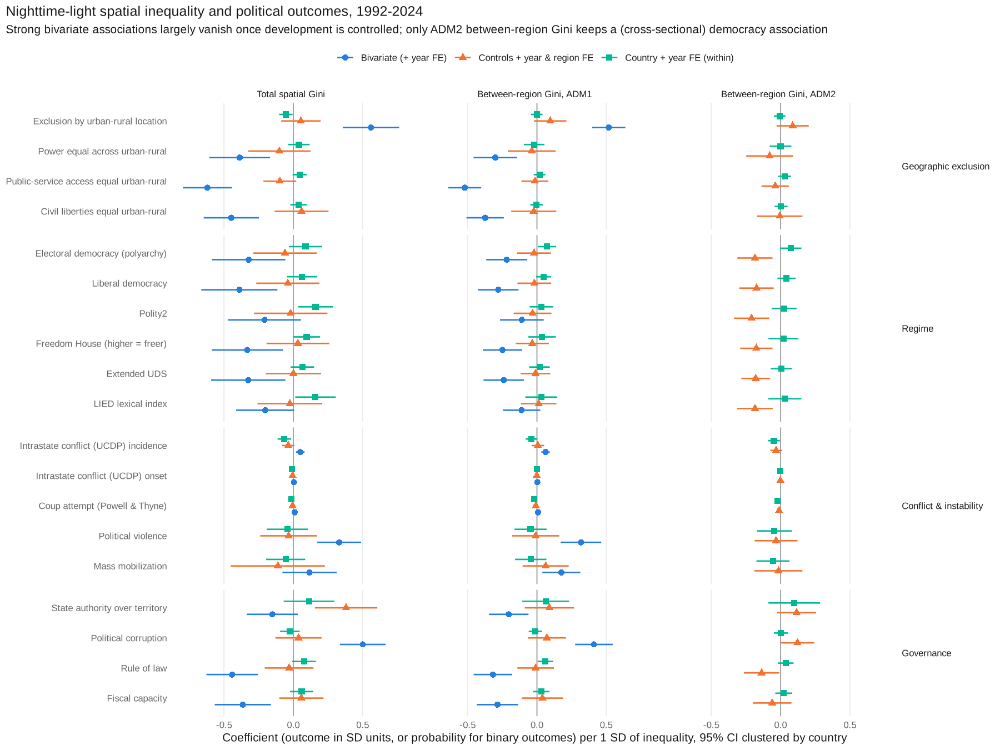

# Does nighttime-light spatial inequality predict political outcomes?

A robustness exercise linking `ntlgini` country-year Gini measures (1992–2024) to
cross-national political outcomes. All the outcome data come from political-science
R packages:

| Source (R package) | Outcomes used |
|---|---|
| **V-Dem v16** (`vdemdata`) | Urban–rural exclusion index and its components (power, public-service access, civil liberties); polyarchy; liberal democracy; political violence; mass mobilization; state authority over territory; corruption; rule of law; fiscal capacity; Powell & Thyne coup attempts |
| **`democracyData`** | Polity5 `polity2`; Freedom House (reversed total); Extended UDS; LIED lexical index |
| **`peacesciencer`** | UCDP/PRIO intrastate armed-conflict incidence and onset (1992–2024); CREG ethnic fractionalization; ruggedness (both used as controls) |
| **`WDI`** | Controls: log GDP pc (PPP), log population, % urban, resource rents |

**Panel:** 5,682 country-years, 173 V-Dem polities. The main specification uses
4,324 country-years from 148 countries.

## Bottom line

**Spatial inequality, as measured here, does not robustly predict political
outcomes once you account for how developed a country is.**

1. **Bivariate associations are strong and point the way theory expects.**
   More spatially unequal countries have more urban–rural political exclusion,
   less democracy, more conflict and political violence, more corruption, and
   weaker rule of law and fiscal capacity. 52 of 76 predictor × outcome pairs
   are significant (49 after Benjamini–Hochberg correction). The pattern holds
   on the main-spec sample too (47/76), so sample composition doesn't explain it.
2. **These associations go away with standard controls.** With controls plus
   year and region fixed effects, 3 of 76 pairs are p < .05 and **0 of 76 survive
   FDR correction**. Under the main specification **no pair counts as robust**
   (robust here means BH p < .05 in the main spec and same-sign p < .05 in at
   least 75% of the 10–12 non-bivariate specifications).
3. **The confounder is development.** Log GDP per capita on its own removes about
   75% of the bivariate coefficient. The light Ginis correlate at −0.55 to −0.76
   with log GDP pc and mean radiance: poor countries have many unlit cells, and
   that mechanically pushes the Gini toward 1. Total Gini has a median of 0.96
   at ADM1.
4. **Adding the inequality measures does not improve prediction.** With 10×
   repeated, country-blocked 10-fold CV, adding all four measures to the control
   model *lowers* out-of-sample R² for 15 of 19 outcomes (median −0.018). The
   gains are tiny: conflict-incidence AUC +0.013, fiscal capacity R² +0.009, and
   territorial authority and exclusion each under +0.015.
5. **Within countries, nothing systematic shows up.** Country + year FE estimates
   are near zero and mixed in sign. Within-region (ADM1) Gini is the exception:
   it is negatively associated with every regime measure within countries
   (e.g., polyarchy −0.26 SD, p < .001). That result is not significant in the
   main pooled spec, though, and only 1 of 76 within-FE tests survives FDR.

### One lead worth pursuing: between-region Gini at **ADM2**

Measured across ADM2 rather than ADM1 units, between-region inequality is
negatively associated with **all six democracy measures**, even with the full
controls (≈ −0.18 SD per SD, BH p < .05 for all six). The follow-up checks
(`04_adm2_followup.R`) show:

- **It comes from the measure, not the sample.** ADM1 between-Gini on the same
  140 countries is null (≈ −0.05).
- It gets **stronger** when ADM1 between-Gini and total Gini are also controlled
  (≈ −0.30 to −0.41). The relevant variation is the inequality *across districts
  within provinces*.
- It holds up in the country-means cross-section (n = 140, ≈ −0.28), without
  region FE, when each of the six world regions is dropped in turn, and in a
  country jackknife (range −0.23 to −0.35).
- **It is zero within countries** (country + year FE ≈ 0).

So this is a persistent **cross-sectional** difference, not a dynamic predictor.
There is also a plausible artefact to rule out. ADM2 boundaries are political
objects: autocracies tend to proliferate and redraw districts, and GADM ADM2
granularity varies across countries. The unit-count control doesn't change the
result, but unit-*size* heterogeneity hasn't been addressed. A natural next step
is to recompute between-unit Gini on a regular grid or on population-equal
zones, which the subunit Parquet tables would allow.

### Other things to note

- **Total Gini → state authority over territory** is *positive* (+0.38 SD,
  BH p = .07, 7/10 specs), which is the opposite of the "harmful" hypothesis.
  The most likely cause is large, mostly empty but state-controlled territories
  such as deserts and the Gulf.
- **Within-region Gini → lower fiscal capacity** (−0.26 SD, BH p = .07, 7/12
  specs) is the closest any ADM1 measure comes to robustness.
- **There is a visible DMSP→VIIRS seam around 2012.** Germany's total Gini, for
  example, jumps from 0.72 to 0.84. Results are similar in DMSP-only and
  VIIRS-only subsamples and with country×era FE. Still, users of the package's
  within-country time series should be aware of it.



## Specification grid (`02_models.R`)

Predictors (each standardized; one predictor per model): total Gini; ADM1
between-region Gini; ADM1 within-region Gini; ADM1 between share. Continuous
outcomes are standardized. Binary outcomes are linear probability models.
SEs are clustered by country.

| ID | Specification |
|---|---|
| S01 / S01b | Bivariate + year FE (full sample / main-spec sample) |
| **S02** | **Controls + year & region FE (main)**: log GDP pc, log pop, % urban, log mean radiance, resource rents, log land area, log # ADM1 units, ethnic fractionalization, ruggedness |
| S03 | S02 without the mean-radiance control |
| S04 | S02 with predictor lagged 3 years |
| S05 | Outcome at t+3, conditional on outcome at t |
| S06 | Between-country: country means, region FE, HC1 SEs |
| S07 | Country + year FE (time-varying controls) |
| S08 | Country×era + year FE (absorbs the DMSP/VIIRS seam) |
| S09 / S10 | S02 in DMSP era (1992–2012) / VIIRS era (2013–2024) |
| S11 | S02 excluding states < 20,000 km² or with < 5 ADM1 units |
| S12 | S02 with ADM2-level measures (ADM2 unit count control) |
| S13 | ADM2-level measures, country + year FE |

## Reproduce

From the package root (requires `fixest`, `dplyr`, `tidyr`, `countrycode`,
`peacesciencer`, `WDI`, `ggplot2`, and `ntlgini` installed):

```sh
Rscript analysis/spatial-inequality-politics/00_get_data.R     # downloads V-Dem, democracyData .rda files, WDI
Rscript analysis/spatial-inequality-politics/01_build_panel.R
Rscript analysis/spatial-inequality-politics/02_models.R
Rscript analysis/spatial-inequality-politics/03_diagnostics.R  # attenuation + cross-validation (~2 min)
Rscript analysis/spatial-inequality-politics/04_adm2_followup.R
Rscript analysis/spatial-inequality-politics/05_figures.R
```

`vdemdata` and `democracyData` are GitHub-only packages. `00_get_data.R` fetches
only their bundled data files at pinned commits (V-Dem v16 `f4dd269`,
democracyData `84290a7`), so neither package needs to be installed.

## Outputs (`output/`)

- `spec_grid.csv`: every estimate (spec × predictor × outcome) with SE, p, BH/Holm p, N, clusters
- `robustness_summary.csv`: per predictor × outcome robustness tally
- `attenuation.csv`: bivariate coefficient after adding each control one at a time
- `cv_prediction.csv`: country-blocked CV, out-of-sample R² / AUC with and without the inequality measures
- `adm2_followup.csv`, `adm2_leave_one_region_out.csv`, `adm2_jackknife.csv`
- `predictor_correlations.csv`, `coefplot.png`
